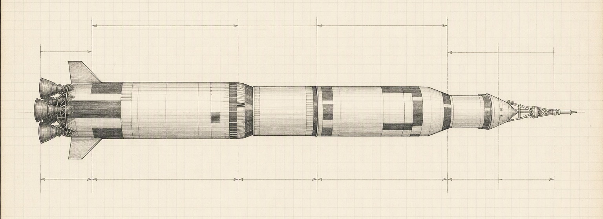
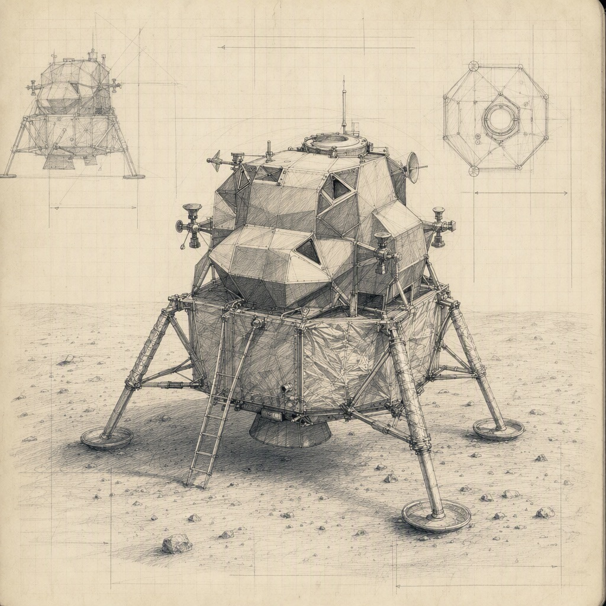

# Apollo: men on the Moon before 1970

> "I believe that this nation should commit itself to achieving the goal, before this decade is out, of landing a man on the Moon and returning him safely to the Earth." President Kennedy, May 25, 1961

Working board for the program office. Everything we decide, build, test and worry about goes here. Background: [Apollo program](https://en.wikipedia.org/wiki/Apollo_program).

- Open threads from the last review
  - Lunar dust: what does it do to seals and suits?
  - Quarantine after return
  - A flag that stays up without air
- Ideas for the public
  - Live TV from the surface
  - Photo of Earth from the Moon

## People

### Headquarters

#### James Webb
NASA Administrator. Keeps Congress and the White House behind the program and the money flowing.
- Works with [George Mueller](#george-mueller)

#### George Mueller
Associate Administrator for Manned Space Flight. Brought **systems management** from the missile programs, and decided on [all-up testing](#all-up-testing).
- Manages [Sam Phillips](#sam-phillips)

#### Sam Phillips
Apollo Program Director from 1964. Runs the program office like a war room: configuration control, schedules, weekly reviews with every center.

### Centers

#### Wernher von Braun
The rocket team.
- Leads [Marshall Space Flight Center](#marshall-space-flight-center)

#### Marshall Space Flight Center
Huntsville, Alabama. Owns the launch vehicle: the [Saturn V](#saturn-v).

#### Robert Gilruth
Ran the Space Task Group since Mercury.
- Leads [Manned Spacecraft Center](#manned-spacecraft-center)

#### Manned Spacecraft Center
Houston, Texas. Owns the [spacecraft](#spacecraft), the astronauts and Mission Control.

#### Kurt Debus
Rocket launches since the V-2 days.
- Leads [Kennedy Space Center](#kennedy-space-center)

#### Kennedy Space Center
Cape Canaveral, Florida. Stacks the vehicle in the Vertical Assembly Building and launches from Pad 39A.

### Engineers

#### John Houbolt
Langley engineer who kept arguing for lunar orbit rendezvous when almost nobody wanted to listen. Wrote straight to headquarters, *outside the chain of command*.
- Argued for [Lunar orbit rendezvous](#lunar-orbit-rendezvous), 1961

#### Max Faget
Shaped the capsules from Mercury onwards, including the [Command and Service Module](#command-and-service-module).

#### Margaret Hamilton
MIT Instrumentation Lab. Leads the onboard flight software; pushes for error detection and recovery the rest of the team calls overkill.
- Responsible for [Apollo Guidance Computer](#apollo-guidance-computer)

## Mission architecture

### Three ways to the Moon
| Mode | How | Catch |
| --- | --- | --- |
| Direct ascent | One giant rocket (Nova) lands the whole ship and flies home | A rocket far too big to build this decade |
| Earth orbit rendezvous | Two launches, assemble the moonship in Earth orbit | Twice the launches, twice the chances to fail |
| Lunar orbit rendezvous | A small lander goes down, the mothership waits in lunar orbit | Docking 380,000 km from home |

### Lunar orbit rendezvous
**Decision, announced July 11, 1962.** One Saturn V per mission and the smallest possible lander. ~~Nova~~ is off the table.

The idea is simple to say and hard to sell. Instead of landing a whole spaceship and flying it home, we leave the mothership in orbit around the Moon and send down a small, light lander built for nothing else. After the surface work, the top half of the lander climbs back up, docks, and is thrown away. Every kilogram we do not carry down and back up saves many kilograms of fuel at launch.

The price is a rendezvous 380,000 km from home, with no second chance and nobody to help. In 1961 most of the agency thought that risk was unacceptable. John Houbolt kept writing memos anyway, and in the end the numbers won: lunar orbit rendezvous needs one launch instead of two, a rocket we can actually build this decade, and a lander small enough to design properly.

Marshall came around in June 1962, when von Braun backed the plan at a briefing for headquarters. The President's science advisers still have doubts, so we answer them with test results, not memos.
- Chosen over [Three ways to the Moon](#three-ways-to-the-moon)
- [x] Win over Marshall (they preferred Earth orbit rendezvous)
- [x] Order the lander from Grumman

## Saturn V

### Saturn V at a glance
Three stages, 110.6 m tall, about 2,900 tonnes at liftoff.



| Stage | Builder | Engines | Propellant |
| --- | --- | --- | --- |
| S-IC | Boeing | 5 F-1 | RP-1 and liquid oxygen |
| S-II | North American Aviation | 5 J-2 | Liquid hydrogen and oxygen |
| S-IVB | Douglas | 1 J-2 | Liquid hydrogen and oxygen |

### S-IC first stage
Boeing. Five F-1 engines, about 34 MN of thrust together. Burns for two and a half minutes and lifts everything off the pad.
- Powered by [F-1 engine](#f-1-engine)

### S-II second stage
North American Aviation. Five J-2 engines on liquid hydrogen. The difficult stage: too heavy, insulation trouble, a test article that split open.
- Powered by [J-2 engine](#j-2-engine)

### S-IVB third stage
Douglas. One J-2 that has to **restart in orbit** for the trans-lunar injection burn.
- Powered by [J-2 engine](#j-2-engine)

### F-1 engine
Rocketdyne. The biggest single-chamber liquid engine ever flown.
- [x] Fix combustion instability (small bombs set off inside running engines until the injector design stayed stable)
- [x] Qualification firings

### J-2 engine
Rocketdyne. Hydrogen and oxygen, restartable in space.

## Spacecraft

### Command and Service Module
North American Aviation. Three crew, the only part that comes home. The heat shield has to survive re-entry at 11 km/s.
- Docks with [Lunar Module](#lunar-module)

### Lunar Module
Grumman. Two stages: the descent stage stays on the Moon, the ascent stage lifts off from it. Every gram counts; parts of the skin are as thin as a few sheets of aluminum foil.



- [x] Weight reduction program
- [ ] First crewed flight in Earth orbit

### Apollo Guidance Computer
MIT Instrumentation Lab. 2,048 words of erasable memory and 36,864 words of fixed **core rope** memory, woven by hand. Astronauts talk to it through the DSKY with verbs and nouns; `P63` starts the landing.

```text
# priority scheduling: when the computer is overloaded,
# drop the least important jobs and keep flying
if executive_is_overloaded():
    show_alarm(1202)
    restart_keeping_high_priority_jobs()
```

- Flies in [Command and Service Module](#command-and-service-module) and [Lunar Module](#lunar-module)

## Test program

### 1967-01-27 Apollo 1 fire
During a launch rehearsal on the pad, a fire in the cabin killed Gus Grissom, Ed White and Roger Chaffee. Pure oxygen at high pressure, flammable materials and a hatch that opened inward.

The test was not even considered hazardous: the rocket held no fuel. The cabin was filled with pure oxygen at slightly more than sea-level pressure, and somewhere in the wiring an arc started a fire that spread in seconds through nylon netting, foam pads and Velcro. The pressure rose so fast that the inward-opening hatch could not be pulled open, and the pad crew needed about five minutes to reach the astronauts.

The review board never found the exact spark, and it did not need to. The fault was the whole design: an atmosphere that made almost anything burn, a cabin full of things that could, and no fast way out. The command module was rebuilt, and no astronaut flew until Apollo 7, almost two years later.
- [x] New hatch that opens outward in seconds
- [x] Nitrogen and oxygen atmosphere on the pad
- [x] Replace flammable materials in the cabin

### All-up testing
Mueller's call in 1963: fly the complete Saturn V stack from the very first flight instead of one stage at a time. Saves years if it works.

### 1967-11-09 Apollo 4
First Saturn V flight, all-up. Everything worked.
- Proved [All-up testing](#all-up-testing)
- Followed by [1968-12-21 Apollo 8](#1968-12-21-apollo-8)

### 1968-12-21 Apollo 8
First people to orbit the Moon: Borman, Lovell, Anders. Decided in August 1968, when the Lunar Module was running late.
- Followed by [1969-05-18 Apollo 10](#1969-05-18-apollo-10)

### 1969-05-18 Apollo 10
Full dress rehearsal. The Lunar Module descends to about 15 km above the surface and comes back up.

## Apollo 11

### Crew
- Neil Armstrong, commander
- Buzz Aldrin, lunar module pilot
- Michael Collins, command module pilot

### Mission sequence
1. Launch, July 16, 1969
2. Trans-lunar injection
3. Lunar orbit insertion
4. *Eagle* undocks from *Columbia*
5. Powered descent and landing, July 20
6. Moonwalk
7. Ascent and rendezvous
8. Trans-Earth injection
9. Splashdown, July 24

### 1202 alarm
During the powered descent the [computer](#apollo-guidance-computer) raised **1202** and **1201** alarms: overloaded, it dropped low-priority jobs and kept flying. In Mission Control, Steve Bales called it a go.
- Followed by [1969-07-20 Tranquility Base](#1969-07-20-tranquility-base)

### 1969-07-20 Tranquility Base
"Houston, Tranquility Base here. The *Eagle* has landed."
- Followed by [Moonwalk](#moonwalk)

### Moonwalk
Six and a half hours after landing, Neil Armstrong backed out of the hatch and climbed down the ladder on the forward leg. A camera mounted on the descent stage sent the picture home, and hundreds of millions of people watched a blurred, ghostly figure step off the footpad. "That's one small step for man, one giant leap for mankind." Armstrong said later that he meant "for a man", and that the "a" was lost somewhere between his microphone and the world.

The surface was not what anyone had feared. The boots sank only a few millimeters into a fine, powdery soil that stuck to everything and packed hard beneath. Armstrong first scooped up a contingency sample, a little bag of soil and rocks, so that the mission would bring something home even if it had to end in a hurry. Then he described what he saw while Buzz Aldrin got ready to follow him about twenty minutes later.

Aldrin tried out ways of moving in one-sixth gravity: a kangaroo hop, a loping run, and long, careful steps when he needed to change direction. Together they unveiled the plaque on the descent stage ladder, with the words "We came in peace for all mankind", and planted the flag, which needed a horizontal rod to stay spread out without air. President Nixon called them from the White House, the longest-distance telephone call ever made.

The real work was science. The crew set up a seismometer to listen for moonquakes, a laser reflector that observatories on Earth still use to measure the distance to the Moon to within centimeters, and a sheet of aluminum foil to catch particles of the solar wind. They filled two boxes with about twenty-one kilograms of rocks and soil, chosen in a rush because the timeline left almost no room for geology.

The moonwalk lasted about two and a half hours, much less than later crews would spend outside, and the two men never went farther than about sixty meters from the lander. Back inside, they found that a circuit breaker needed for the ascent engine had snapped off. Aldrin pushed it in with a felt-tip pen. After a short and restless sleep in the cramped cabin, *Eagle* lifted off to meet Michael Collins in *Columbia*, leaving the descent stage, the flag and a pile of equipment behind.

## Risks and open questions

- [x] Surveyor landers confirm the surface can hold a spacecraft
- [ ] Settle the quarantine procedure with the Public Health Service

### Pogo oscillation
The vehicle shakes along its length; on Apollo 6 it got bad enough to worry everyone. Fix for the [S-II second stage](#s-ii-second-stage): helium in the propellant lines to damp it.

### Lunar Module weight
Still over the limit. If the [Lunar Module](#lunar-module) does not come down, the landing has no margin left.

### Will the computer keep up?
Radar data plus crew requests could overload the [Apollo Guidance Computer](#apollo-guidance-computer) during descent.

<!-- skiss
Lunar orbit rendezvous: blue
Saturn V at a glance: size 460 x 0
All-up testing: blue
1969-07-20 Tranquility Base: green
Pogo oscillation: red
Lunar Module weight: red
Will the computer keep up?: yellow
Colors: red means Risk, yellow means Open question, green means Done, blue means Decision
-->
