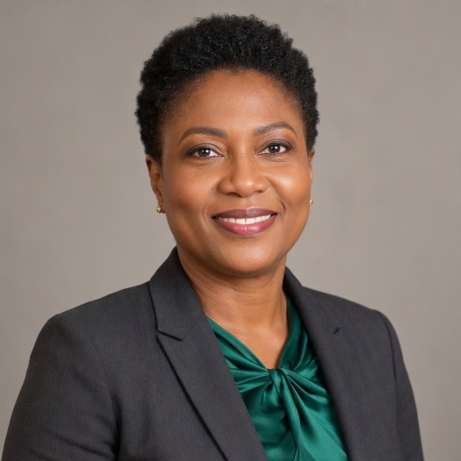
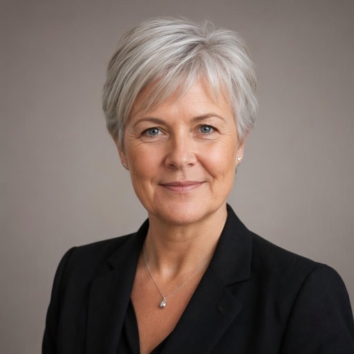
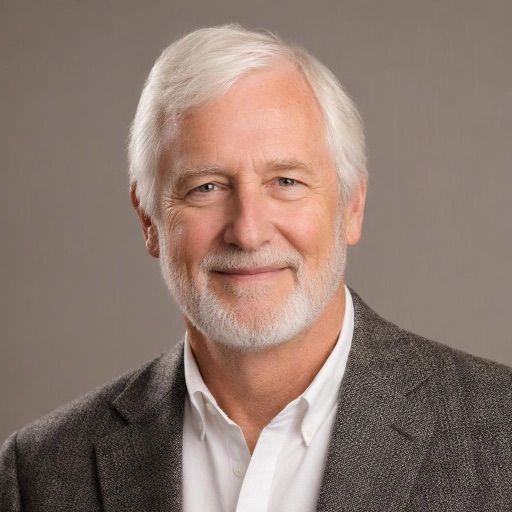
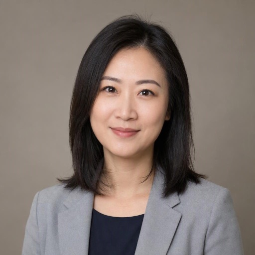
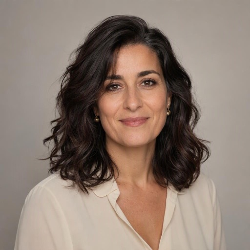
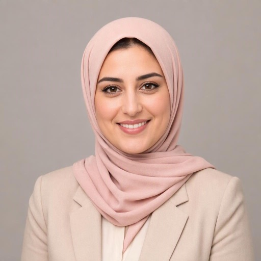

# Kestrel Labs

Who we are, who does what, and who to ask. Kestrel Labs makes route planning software for delivery fleets: fifteen people, an office in Stockholm and a few of us remote. Updated October 2026.

| Team | Lead | People |
| --- | --- | --- |
| Leadership | Amara Okafor | 2 |
| Engineering | Mei Lin Chen | 5 |
| Product and Design | Sofia Rossi | 3 |
| Sales and Customers | Daniel Kowalski | 3 |
| People and Finance | Ingrid Solberg | 2 |

## Leadership

### Amara Okafor

**Chief Executive Officer**, co-founder. Investors, strategy and the big customers. Ask her about anything; she answers within a day.

### Lukas Brandt

**Chief Technology Officer**, co-founder. Wrote the first routing engine on a kitchen table in 2019.
- Reports to [Amara Okafor](#amara-okafor)

## People and Finance

### Ingrid Solberg

**Head of People and Operations**. Hiring, onboarding, the office and the summer party.
- Reports to [Amara Okafor](#amara-okafor)

### Samuel Cohen

**Finance Manager**. Budgets, payroll and the board reports. Part time, three days a week.
- Reports to [Ingrid Solberg](#ingrid-solberg)

## Engineering

### Mei Lin Chen

**Engineering Manager**. Runs planning, hiring and the weekly demo for the whole engineering team.
- Reports to [Lukas Brandt](#lukas-brandt)

### Rafael Moreno

**Senior Backend Engineer**. The routing engine and the map data. On parental leave until February.
- Reports to [Mei Lin Chen](#mei-lin-chen)

### Priya Raman

**Machine Learning Engineer**. Predicts delivery times and traffic. Works remote from Bangalore.
- Reports to [Mei Lin Chen](#mei-lin-chen)

### Jonas Lindqvist

**Frontend Engineer**. The dispatcher dashboard and the driver app. Joined in March.
- Reports to [Mei Lin Chen](#mei-lin-chen)

### Kwame Mensah

**Site Reliability Engineer**. Keeps the platform up and the cloud bill down. On call every fourth week.
- Reports to [Mei Lin Chen](#mei-lin-chen)

## Product and Design

### Sofia Rossi

**Head of Product**. Owns the roadmap and says no to most feature requests, kindly.
- Reports to [Amara Okafor](#amara-okafor)

### Hiro Tanaka

**Product Designer**. The design system, the dashboard and every icon in the product.
- Reports to [Sofia Rossi](#sofia-rossi)

### Leila Haddad

**UX Researcher**. Rides along with drivers and dispatchers to see how the product is really used. Joined in May.
- Reports to [Sofia Rossi](#sofia-rossi)
- Shares interviews with [Grace Mwangi](#grace-mwangi)

## Sales and Customers

### Daniel Kowalski

**Head of Sales**. Twenty years of selling logistics software across Europe.
- Reports to [Amara Okafor](#amara-okafor)

### Aroha Walker

**Account Executive**. New markets: the Nordics and Australia. Works remote from Auckland. Joined in August.
- Reports to [Daniel Kowalski](#daniel-kowalski)

### Grace Mwangi

**Customer Success Manager**. Onboards every new customer and runs the quarterly check-ins.
- Reports to [Daniel Kowalski](#daniel-kowalski)

## Hiring

### Open roles
- [ ] Senior Android engineer (Engineering)
- [ ] Data engineer (Engineering)
- [ ] Sales development representative (Sales)
- [x] UX researcher (filled by Leila)
- [x] Account executive (filled by Aroha)

### First week at Kestrel
1. Laptop, accounts and a desk on day one
2. Lunch with your manager
3. Ride along with a delivery driver
4. Ship something small to production by Friday

<!-- skiss
Rafael Moreno: yellow
Priya Raman: blue
Jonas Lindqvist: green
Leila Haddad: green
Aroha Walker: blue
Colors: green means New this year, blue means Remote, yellow means On leave
-->
