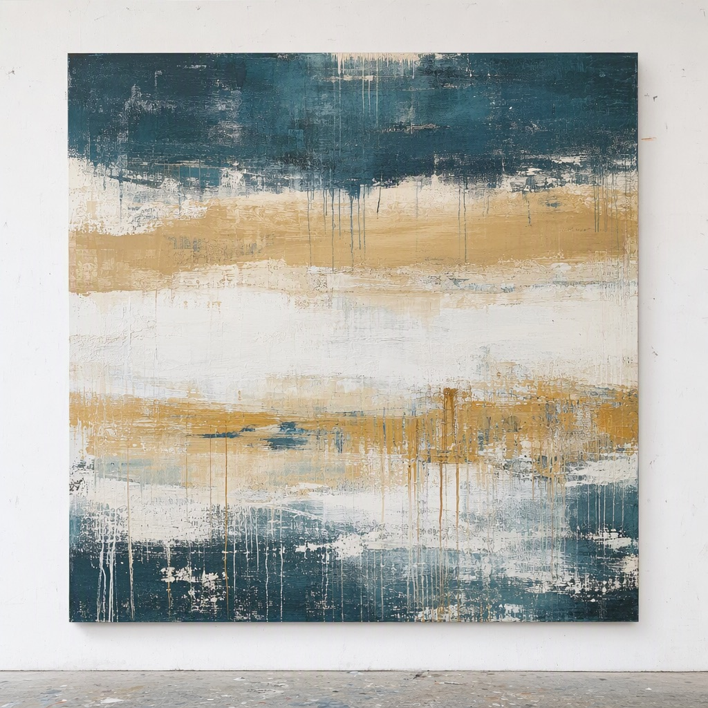
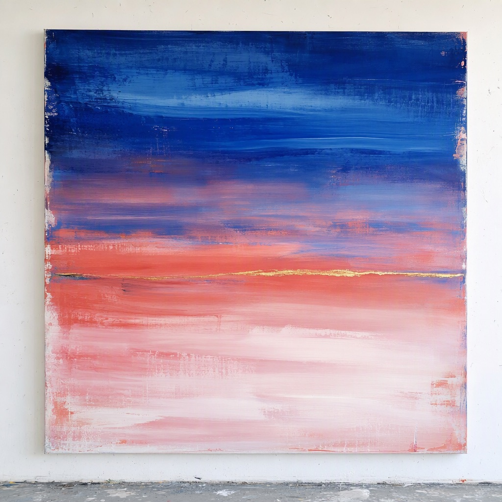
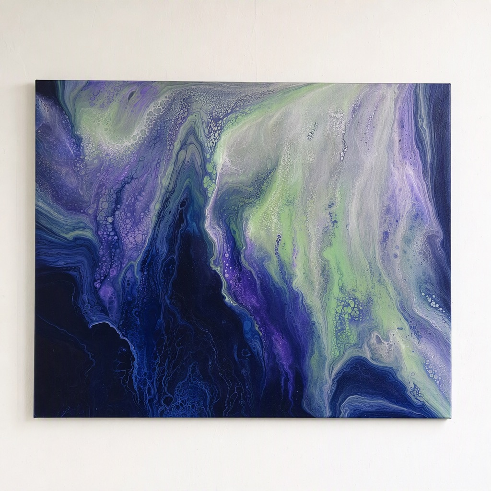
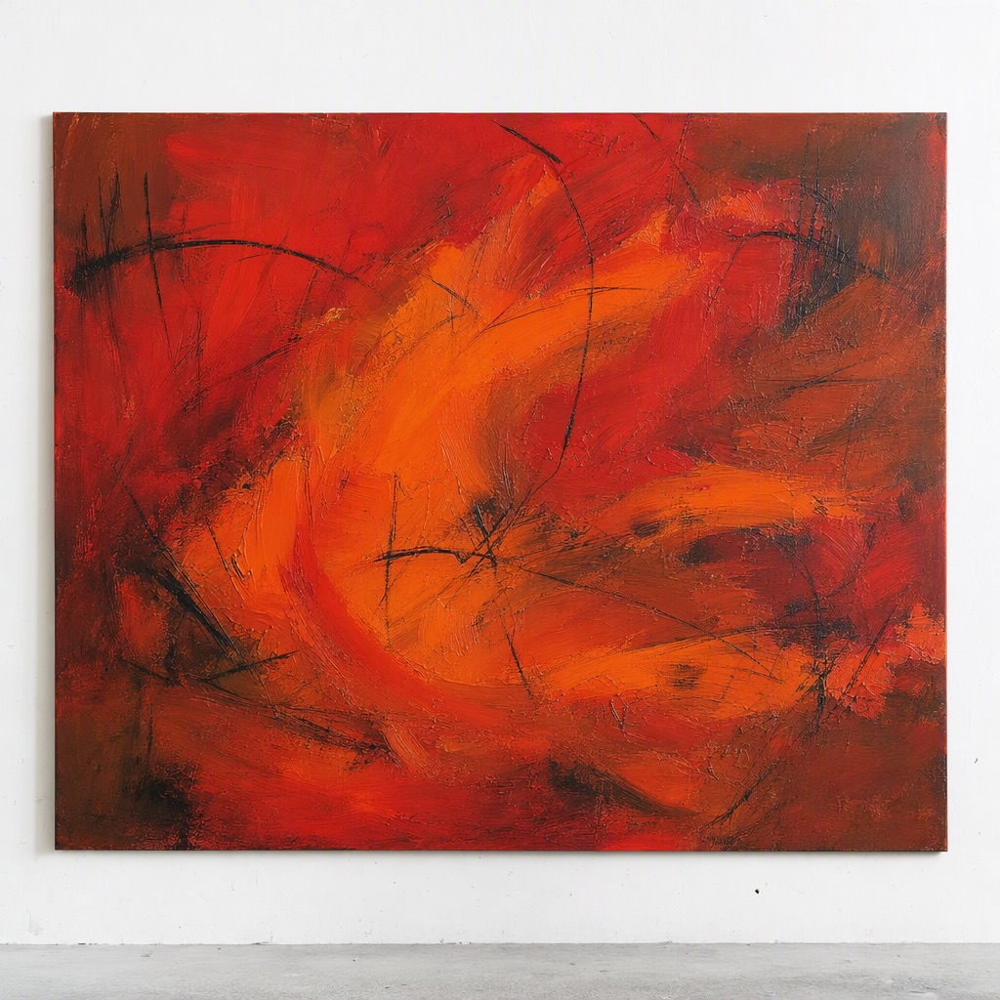
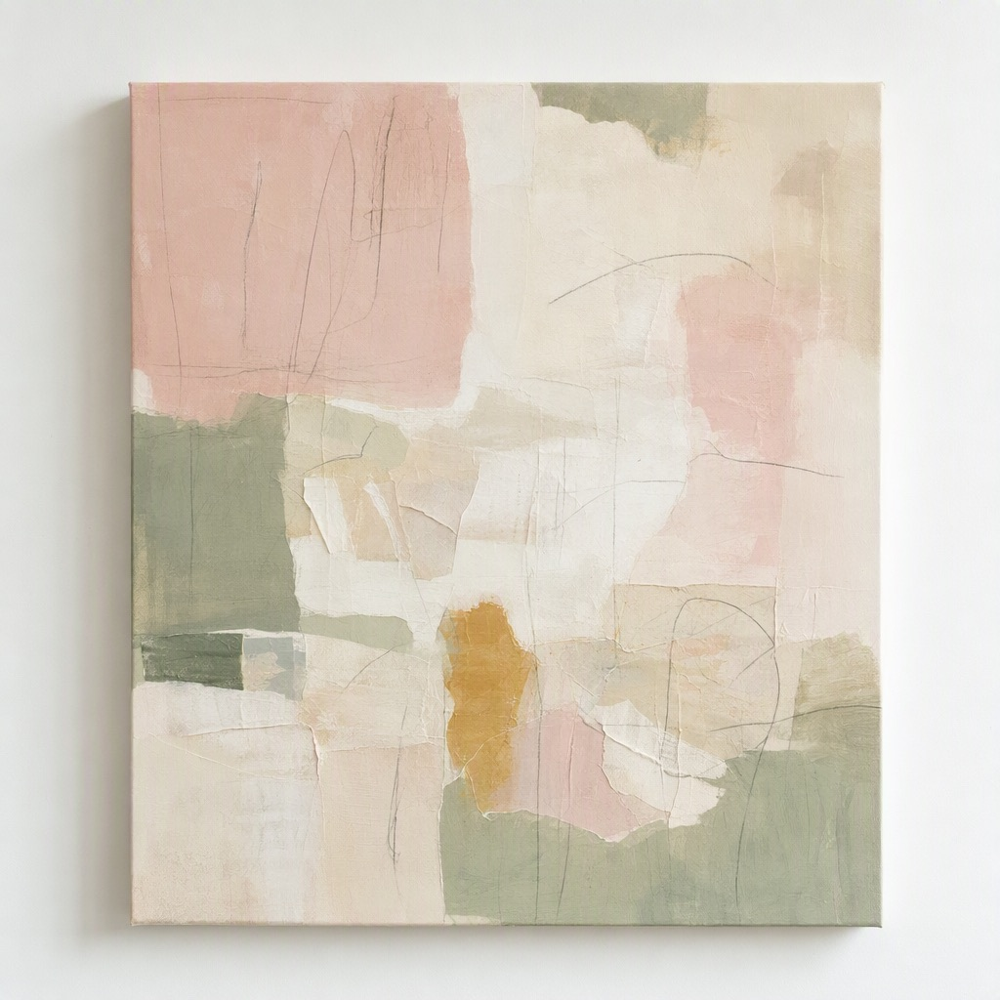
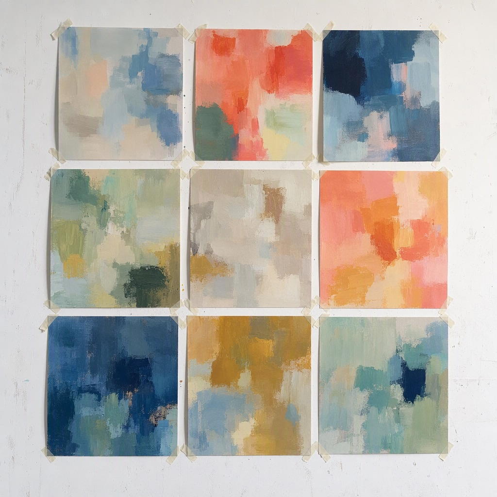
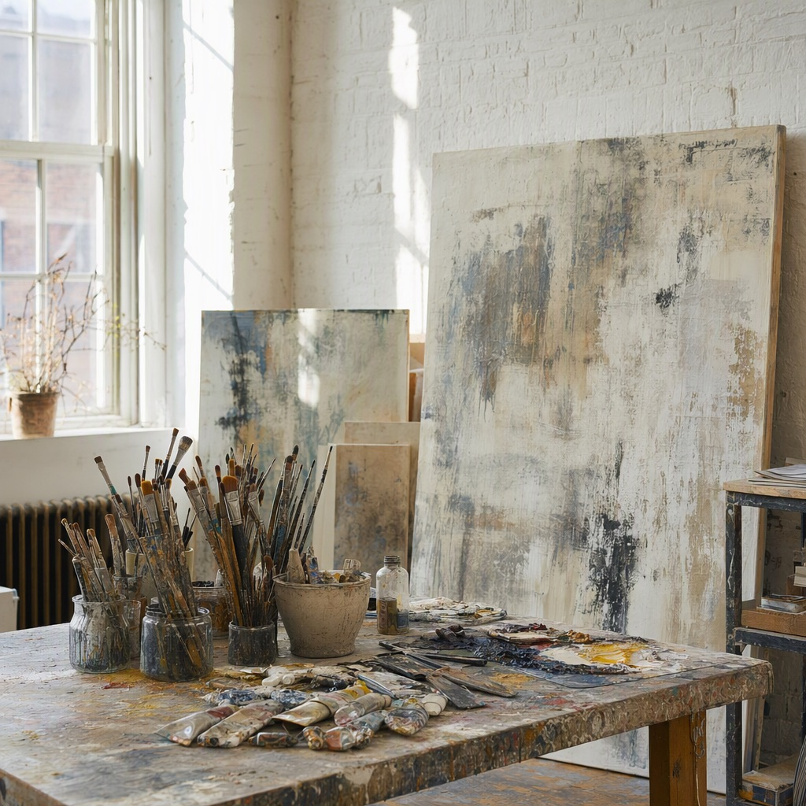

# Studio notebook

Everything about the painting lives here: ideas, poems, finished work, shows, materials and the boring practical bits. Started in the spring of 2024, when I finally got a room with a north window.

- Things I keep coming back to
  - Water at the very edge of the shore
  - Light through birch leaves
  - The sky ten minutes after sunset
  - Old walls where the paint has peeled in layers
- Someday
  - A painting as tall as the studio wall
  - Teach a weekend course for beginners
  - A residency somewhere with a different light

## Ideas

### Sea and sand
Horizontal bands, like looking at the shore from a dune. Scrape everything back with the palette knife so the earlier layers show through.
- Became [Tidelines](#tidelines)

### Aurora
Poured veils of light over a very dark ground. Glossy, almost wet looking.
- Became [Northern light](#northern-light)

### Red earth
Heat. Burnt ground. Scratch charcoal through wet red paint.
- Became [Ember](#ember)

### Breathing room
Soft, quiet paintings to make after the loud ones. Collage, pencil, a lot of white.
- Became [Quiet garden](#quiet-garden)

### Rooms of color
A series where each painting is one color, but every brushstroke a slightly different version of it. Start with blue. Needs big canvases and a lot of patience.

### Sparks
- Paint on the back of old sea charts
- Let the sound of rain set the rhythm of the brushstrokes
- One month with only three colors
  - Week 1: ultramarine, yellow ochre, white
  - Week 2: phthalo green, quinacridone rose, white
  - Week 3: burnt sienna, payne's gray, white
- Photograph a painting every day while it grows, then make a flip book
- Paint the same view at five different times of day

## Works

### Tidelines

#### Tidelines no. 1


100 x 100 cm, acrylic on canvas, 2024. The first one that felt like *mine*. **Sold** at the autumn group show.

#### Tidelines no. 2
80 x 100 cm, 2024. Overworked it until it went gray and muddy. ~~Finished~~ Painted over in March 2025; the bottom layer still shows through in the corners, which I like.

#### Tidelines no. 3


120 x 120 cm, 2025. Glazes, at least twelve thin layers. The gold line was an accident with the wrong brush.

### Northern light

#### Northern light no. 1
A failed pour: too much water, the paint cracked while drying. Kept it as a test panel for varnish.

#### Northern light no. 2


100 x 80 cm, 2025. Pouring medium plus a few drops of silicone for the cells. Took three days to dry flat.

### Ember

#### Ember field


150 x 100 cm, 2025. Painted standing, with the canvas on the floor. **Sold** to a private collector after the solo show.

### Quiet garden

#### Quiet garden no. 1


60 x 70 cm, 2026. Acrylic, tissue paper and pencil. Still deciding if it is done.

#### Quiet garden no. 2
Underpainting only: sage and cream. Waiting for the right pink.

### Color studies

#### Nine small studies


20 x 20 cm each, summer 2026. One palette per study, painted in an afternoon each. Some of them are better than the big paintings.

## Poems

### Low tide
The sea folds back its blue sheet\
and leaves the shore\
written over in water.

I read it with my feet,\
a language of ridges,\
erased before evening.

*Written for [Tidelines no. 1](#tidelines-no-1).*

### Birch light
Through the birches\
the light comes in pieces,\
green coins on the floor.

I want a painting\
you cannot hold still,\
that keeps on falling.

*Written for [Quiet garden no. 1](#quiet-garden-no-1).*

### After the fire
Not the flame\
but what it leaves:\
the warm red of the ground,\
the black lines\
where something burned to its bones\
and stayed.

*Written for [Ember field](#ember-field).*

### Kitchen table, six in the morning
Coffee, a pencil,\
the radio low.\
Every color I need\
is already in the cup,\
in the window,\
in your sleeping face.

### Northern winter
The dark is not empty.\
It is the ground\
the light needs\
to be seen at all.

*Written for [Northern light no. 2](#northern-light-no-2).*

## Studio

### The room


North window, white brick, concrete floor that can take any spill. Rent is due on the 25th.

### Morning routine
1. Coffee, no phone
2. Look at yesterday's work for ten minutes before touching it
3. Clean palette, fresh water
4. Paint until the light changes

### Light
The north window is perfect until about three in the afternoon in winter. After that, daylight lamps at 5000 K. Never judge colors under the yellow ceiling lamp.

## Materials

### Paints
| Color | Brand | Notes |
| --- | --- | --- |
| Phthalo blue (green shade) | Golden Heavy Body | Very strong; a drop goes a long way |
| Ultramarine blue | Liquitex Heavy Body | The tidelines blue |
| Quinacridone rose | Golden Fluid | Gorgeous in glazes |
| Cadmium red medium | Liquitex Heavy Body | Ember. Expensive, worth it |
| Yellow ochre | Winsor & Newton Galeria | Cheap and lovely |
| Titanium white | Golden Heavy Body | Buy the big jar |
| Payne's gray | Liquitex Soft Body | Instead of black |

### Mediums
- Gesso for every canvas, two thin coats
- Glazing medium for the transparent layers
- Pouring medium, about two parts to one part paint
- Matte gel medium for collage
- Satin varnish, two coats, after at least two weeks of drying

### Tools
- Italian palette knives, three sizes
- Wide flat brushes (5 and 10 cm)
- An old credit card for scraping
- Spray bottle
- Masking tape, the good kind that does not tear the canvas

### Where to buy
- [Golden Artist Colors](https://www.goldenpaints.com) heavy body and fluid acrylics, technical sheets
- [Liquitex](https://www.liquitex.com) heavy and soft body, good mediums
- [Winsor & Newton](https://www.winsornewton.com) Galeria for studies and underpainting
- [Jackson's Art Supplies](https://www.jacksonsart.com) big canvases and bulk orders

### Shopping list
- [x] Gesso, 5 liters
- [x] Masking tape
- [ ] Phthalo blue, large tube
- [ ] Two 120 x 120 cm canvases
- [ ] Palette knife set, the long ones
- [ ] Daylight bulbs for the winter

## Techniques

### Scraping back
Paint a thick layer, let it skin over for twenty minutes, then drag it away with the knife or the card. What stays in the weave of the canvas is the interesting part.

### Pouring
Mix in cups the night before so the bubbles rise.

```text
1 part fluid acrylic
2 parts pouring medium
a little water until it runs like warm honey
optional: 2 drops silicone oil for cells
```

Pour on a level table. Cover with a box against dust. Do not touch for three days.

### Glazing
Thin color with glazing medium, never just water. Let every layer dry fully. Twelve thin layers glow; three thick ones just look heavy.

### Collage
Tissue paper under matte gel medium, then paint over it. Torn edges look better than cut ones.

## Inspiration

### Hilma af Klint
Painted huge, spiritual abstractions long before anyone called it abstract art, and asked for them not to be shown until long after her death. The scale of her biggest paintings changed how I think about size.

### Joan Mitchell
Big gestures that still feel like landscape. Look at how she leaves bare canvas.

### Helen Frankenthaler
Soak-stain: thinned paint poured onto raw canvas. Try it with fluid acrylics.

### Mark Rothko
Edges that breathe. Colors that seem to hover.

### Places
- The shoreline at low tide in August
- The birch forest behind the house
- The harbor in winter, all grays and one orange buoy

## Shows

### Galleri Ljusgården
Small gallery by the harbor. Lovely light, owner Maria is honest about what sells.
- Showed [Tidelines no. 1](#tidelines-no-1), autumn group show 2024

### Studio Nord
Old printworks turned gallery. My first solo show, "Tides and Light", November 2025.
- Showed [Tidelines no. 3](#tidelines-no-3) and [Ember field](#ember-field)
- [x] Hang nine paintings
- [x] Price list and labels
- [x] Opening night

### Spring open call
Juried show at the city art hall, spring 2027. Theme: water.
- [ ] Choose three works (Tidelines no. 3? Northern light no. 2?)
- [ ] Artist statement, 200 words
- [ ] Apply before January 15, 2027

### Framer
Johan at the frame shop on the corner. Floating frames in oak take about three weeks.

## Business

### Prices
| Size | Price |
| --- | --- |
| Up to 40 x 40 cm | 2,500 kr |
| Up to 80 x 80 cm | 6,500 kr |
| Up to 120 x 120 cm | 12,000 kr |
| Larger | Ask |

### Sold
- Tidelines no. 1, 2024
- Ember field, 2025
- Two color studies, 2026

### Online
- [x] Website with one page per series
- [ ] Photograph the new studies in daylight
- [ ] Post a work-in-progress every Sunday

## To do

### This week
- [ ] Varnish Tidelines no. 3
- [ ] Gesso the two new canvases
- [x] Pay studio rent
- [ ] Call the framer about the spring show

### Before the spring show
- [ ] Choose the works
- [ ] Order frames
- [ ] Write the artist statement
- [ ] Print the price list

## Journal

### 2024-04-12 First day in the studio
Swept the floor, put up the table, painted nothing. Sat by the window until it got dark. Perfect day.

### 2024-09-28 First sale
Someone bought Tidelines no. 1 at the group show and asked me to sign the back. I had to go outside for a minute.

### 2025-03-02 Painting over
Painted over Tidelines no. 2. It hurt for an hour and then felt like freedom.

### 2025-11-14 Opening night
Studio Nord was full. Ember field sold before the speeches. Remember: eat something before the opening next time.

### 2026-06-21 Midsummer studies
Nine small studies in nine afternoons. The three-color month taught me more than a year of buying new tubes.

### 2026-10-18 Gold
Started a small painting in warm gold and blush pink. Everything feels like a beginning.

<!-- skiss
Rooms of color: blue
Tidelines no. 1: green
Ember field: green
Quiet garden no. 1: yellow
Quiet garden no. 2: yellow
Spring open call: red
Before the spring show: red
Colors: red means Deadline, yellow means In progress, green means Sold, blue means Idea
-->
